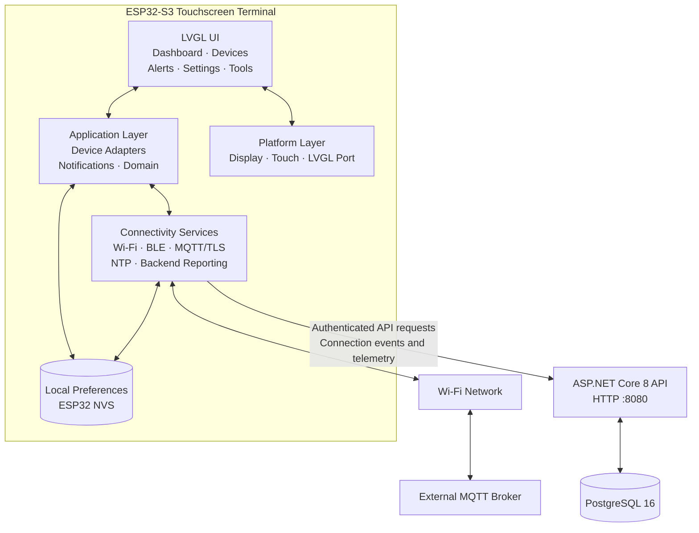

# IoT Commander

**A modular ESP32-S3 touchscreen platform for IoT monitoring, device connectivity, and command control.**

IoT Commander combines an LVGL-based embedded interface, Wi-Fi and Bluetooth Low Energy discovery, MQTT telemetry and commands, and an optional ASP.NET Core backend backed by PostgreSQL.

The project is designed as a reusable foundation for future IoT products, with separate UI, application, connectivity, platform, storage, and backend modules.

## Contents

- [Overview](#overview)
- [Architecture](#architecture)
- [Hardware and technology stack](#hardware-and-technology-stack)
- [Features](#features)
- [Repository structure](#repository-structure)
- [Build and flash firmware](#build-and-flash-firmware)
- [Configure the terminal](#configure-the-terminal)
- [Developer tools](#developer-tools)
- [Troubleshooting](#troubleshooting)
- [.NET and PostgreSQL backend](#net-and-postgresql-backend)
- [API reference](#api-reference)
- [Security considerations](#security-considerations)
- [Extending the platform](#extending-the-platform)
- [Development status](#development-status)

## Overview

IoT Commander runs on the VieweSmart UEDX24320028E-WB-A V1.1, an ESP32-S3 display board with a 240 × 320 portrait interface.

The embedded application provides a touchscreen dashboard and connectivity tools. MQTT supplies the first implemented device messaging protocol. The optional backend receives terminal connection events and numeric telemetry, then persists them in PostgreSQL.

The firmware can operate without the backend. Backend reporting is an additional capability for systems that need centralized storage and API access.

## Architecture



### Architectural responsibilities

| Layer | Responsibility |
|---|---|
| UI | Touchscreen navigation, dashboards, discovery controls, alerts, and configuration |
| Application | Domain models, device adapter contracts, notification handling, and coordination |
| Connectivity | Wi-Fi scanning and connection, BLE discovery, MQTT messaging, time synchronization, and backend reporting |
| Platform | LCD and touch integration with LVGL |
| Storage | Local configuration and saved-system preferences using ESP32 NVS |
| Backend API | API-key validation, terminal registration/records, connection-event ingestion, and telemetry ingestion/querying |
| Database | Persistent terminal, connection-event, and telemetry records |

The MQTT broker is external to the included Docker Compose services. IoT Commander connects to a broker configured by the operator.

## Hardware and technology stack

### Hardware

- VieweSmart UEDX24320028E-WB-A V1.1
- ESP32-S3 microcontroller
- 240 × 320 SPI LCD in portrait orientation
- Capacitive I²C touchscreen
- 16 MB flash configuration
- Octal PSRAM configuration

### Software

| Component | Technology |
|---|---|
| Embedded firmware | C++ and Arduino framework |
| UI | LVGL 8.4 |
| Build system | PlatformIO |
| Display integration | ESP32 Display Panel and ESP32 IO Expander |
| Wireless connectivity | ESP32 Wi-Fi and Bluetooth LE |
| Messaging | MQTT using PubSubClient |
| Payload parsing | ArduinoJson |
| Local persistence | ESP32 Preferences / NVS |
| Backend | ASP.NET Core 8 |
| Data access | Entity Framework Core with Npgsql |
| Database | PostgreSQL 16 |
| Local deployment | Docker Compose |

## Features

### Touchscreen interface

- Modular Dashboard, Devices, Alerts, Settings, and Tools screens.
- Display diagnostics including uptime, IP address, Wi-Fi signal strength, and free internal heap.
- Touch-based configuration and notification review.
- Separate screen modules and reusable UI components.

### Connectivity and device discovery

- Asynchronous Wi-Fi network scanning.
- Protected Wi-Fi network connection through the touchscreen interface.
- Bluetooth LE advertisement discovery.
- Local saved-system records and connection status.
- An adapter contract for future device-specific integrations.

BLE discovery currently identifies nearby advertisements. It does not automatically pair with or control arbitrary Bluetooth peripherals.

### Automatic server discovery

- When the backend is unreachable, the terminal looks up its server by mDNS name (`<name>.local`) and accepts only an address on its own subnet.
- If the lookup fails, it falls back to the addresses saved for the current Wi-Fi network.
- After the backend has worked on a network for about 45 seconds, its addresses are saved for that network (up to five networks).
- New addresses are applied through the normal settings path, so MQTT and the backend reconnect on their own.
- The lookup runs at most once a minute and only while the backend is unreachable.
- The server name is the `kServerName` constant in `src/connectivity/ServerLocator.cpp`; set it to your server's hostname.
- Some hotspots block mDNS between clients. Saved addresses exist only for networks where discovery has worked once.
- MQTT connects to the discovered IP address, so the broker certificate must list that IP. See [Broker certificate re-signing](#broker-certificate-re-signing).

### Tools page and self-test

- The Tools page (eye icon in the bottom bar) shows live checks for Wi-Fi, MQTT, backend, time, heap and PSRAM, the Wi-Fi signal strength and channel, and the readings currently received over MQTT.
- The `SELFTEST` USB command prints the same checks as PASS/FAIL lines over serial.

### MQTT telemetry and commands

- Configurable broker address, port, credentials, topics, and TLS root CA.
- Numeric telemetry payloads, for example `23.5`.
- JSON telemetry objects containing numeric fields, for example:

  ```json
  {
    "temperature": 23.5,
    "humidity": 51
  }
  ```

- Up to four named numeric readings retained for dashboard display.
- Configurable visible JSON fields and dashboard tile labels.
- Configurable threshold alerts.
- Confirmed ON/OFF command publishing to a configured MQTT command topic.
- Non-retained ON/OFF command messages.

MQTT commands publish messages; they do not guarantee that the receiving device has executed the requested action.

### Time and notifications

- NTP time synchronization.
- Configurable POSIX timezone.
- Local notifications for connectivity, MQTT, configuration, and threshold events.

### Optional backend integration

- API-key-protected API routes under `/api/v1`.
- Terminal records and connection-event persistence.
- Numeric telemetry ingestion and retrieval.
- Queued terminal reporting when network connectivity is unavailable.
- PostgreSQL persistence using a Docker volume.

## Repository structure

```text
IoT Commander/
├── boards/
│   └── BOARD_VIEWE_UEDX24320028E_WB_A.json
├── include/
│   ├── app/
│   │   ├── BackendService.h
│   │   ├── ConnectivityService.h
│   │   ├── DeviceAdapter.h
│   │   ├── Domain.h
│   │   ├── MqttService.h
│   │   ├── NotificationCenter.h
│   │   ├── ServerLocator.h
│   │   ├── SettingsStore.h
│   │   └── TimeService.h
│   ├── platform/
│   │   └── LvglPort.h
│   └── ui/
│       ├── ScreenModule.h
│       ├── UiComponents.h
│       └── UiManager.h
├── src/
│   ├── app/
│   │   ├── DeviceAdapter.cpp
│   │   └── NotificationCenter.cpp
│   ├── connectivity/
│   │   ├── BackendService.cpp
│   │   ├── ConnectivityService.cpp
│   │   ├── MqttService.cpp
│   │   ├── ServerLocator.cpp
│   │   └── TimeService.cpp
│   ├── platform/
│   │   └── LvglPort.cpp
│   ├── storage/
│   │   └── SettingsStore.cpp
│   ├── ui/
│   │   ├── screens/
│   │   │   ├── AlertsScreen.cpp
│   │   │   ├── DashboardScreen.cpp
│   │   │   ├── DevicesScreen.cpp
│   │   │   ├── SettingsScreen.cpp
│   │   │   └── ToolsScreen.cpp
│   │   ├── UiComponents.cpp
│   │   └── UiManager.cpp
│   ├── lv_conf.h
│   └── main.cpp
├── backend/
│   ├── IoTCommander.Api/
│   │   ├── Data.cs
│   │   ├── Program.cs
│   │   ├── IoTCommander.Api.csproj
│   │   └── Dockerfile
│   ├── docker-compose.yml
│   └── .env                 # Local secrets; do not commit
├── tools/
│   ├── cert/
│   │   └── resign-broker-cert.sh
│   ├── provision/
│   │   └── set-mqtt-password.py
│   └── simulator/
│       └── simulate.py
├── platformio.ini
├── .gitignore
└── README.md
```

## Build and flash firmware

### Prerequisites

- Ubuntu or another supported development environment.
- PlatformIO Core or the PlatformIO IDE extension.
- USB data cable for the display board.
- Required USB/serial permissions on Linux.

### Build

From the repository root:

```bash
pio run
```

### Upload

Connect the board, then run:

```bash
pio run --target upload
```

If PlatformIO cannot identify the correct serial port, specify it explicitly:

```bash
pio run --target upload --upload-port /dev/ttyACM0
```

Replace `/dev/ttyACM0` if your board uses another port.

### Serial diagnostics

```bash
pio device monitor --baud 115200
```

The first build downloads the dependencies declared in `platformio.ini`.

## Configure the terminal

Use the touchscreen Settings screen to configure MQTT and optional backend reporting.

### Wi-Fi

1. Open Devices.
2. Scan for available networks.
3. Select the intended network.
4. Enter the network password and connect.

Use a trusted network and ensure that the terminal can reach the configured MQTT broker and backend.

### MQTT

Configure the broker hostname or IP address, port, optional credentials, telemetry topic, command topic, and root CA certificate when TLS is enabled.

For a TLS-enabled broker, configure the appropriate trusted PEM root CA. Do not disable certificate validation to work around certificate errors.

### Timezone

The timezone field uses POSIX timezone syntax. Its UTC-offset sign convention is reversed from many conventional UTC offset labels. For example, `UTC-3` represents UTC+3.

### Backend

Set the backend URL and the same API key configured for the backend service. For a development machine on a trusted LAN, the URL takes this form:

```text
http://<UBUNTU_LAN_IP>:8080
```

Find a likely LAN address with:

```bash
ip -4 addr
```

Choose the address reachable from the terminal's Wi-Fi network, not `127.0.0.1`. The loopback address only refers to the computer making the request.

The backend URL, API key, and optional backend root CA can also be provisioned over a trusted physical USB serial connection using the documented `CONFIGURE_BACKEND` command. Send `STATUS` to inspect connection and time status without revealing the API key. Send `SELFTEST` to run the Tools-page health checks and print PASS/FAIL lines. MQTT settings can be provisioned the same way with `CONFIGURE_MQTT ` followed by a JSON object (`host`, `port`, `username`, `password`, `rootCa`, `telemetryTopic`, `commandTopic`); fields you leave out keep their saved values.

## Developer tools

The `tools/` folder holds PC-side helpers. None of them contain credentials: secrets come from environment variables.

### Device simulator

`tools/simulator/simulate.py` publishes fake telemetry to the broker, so you can test the terminal, alert rules and backend without real sensors.

Setup:

```bash
pip install paho-mqtt
cp <path-to-your-broker-ca>.crt tools/simulator/ca.crt   # public CA certificate; ignored by Git
```

Run (enter the credentials one command at a time; the password is not echoed):

```bash
read -rp "MQTT user: " MQTT_USER
read -rsp "MQTT password: " MQTT_PASS; echo
export MQTT_USER MQTT_PASS
python3 tools/simulator/simulate.py --host <BROKER_IP> --cafile tools/simulator/ca.crt --scenario normal
```

Useful options: `--ids` (comma-separated device IDs), `--topic` (template, default `devices/{id}/telemetry`), `--fields`, `--interval`, `--duration`, and `--no-hostname-check` for local testing.

| Scenario | Behavior |
|---|---|
| `normal` | Smoothly varying temperature and humidity |
| `spike` | Periodic humidity and temperature spikes that trip alert rules |
| `flatline` | Values freeze, like a stuck sensor |
| `dropout` | Silence for 60 s out of every 120 s |
| `burst` | 20 rapid messages once a minute |
| `drift` | Temperature slowly rises |

The terminal accepts a JSON object of numeric fields, so the simulator output works on any terminal subscribed to the topic.

### Broker certificate re-signing

The terminal connects to the broker by IP address, so the broker certificate must list that IP. On a new network the PC gets a new IP, and TLS fails until the certificate lists it.

`tools/cert/resign-broker-cert.sh` is a NetworkManager dispatcher script for a Mosquitto broker on Linux. When the PC joins a network it re-signs the server certificate with the PC's current addresses, verifies the result, backs up the old certificate and restarts the broker (restoring the backup if the broker fails to start). It changes nothing when the certificate already lists every current address. The terminal trusts the CA, not the server certificate, so it needs no reflashing.

It assumes `ca.crt`, `ca.key`, `server.csr` and `server.key` in `/etc/mosquitto/certs`. Install and test:

```bash
sudo install -m 755 -o root -g root tools/cert/resign-broker-cert.sh /etc/NetworkManager/dispatcher.d/90-iotcommander-cert
sudo /etc/NetworkManager/dispatcher.d/90-iotcommander-cert --force
journalctl -t iotcommander-cert -n 5
```

The script runs as root and uses the CA private key. Keep `ca.key` readable by root only. For production, use a proper CA or an automated certificate flow instead.

### Changing the MQTT password

1. Set the new password on the broker (omit `-c`, which would recreate the file and delete other users):

   ```bash
   sudo mosquitto_passwd /etc/mosquitto/passwd <user>
   sudo systemctl restart mosquitto
   ```

2. Push it to the terminal over USB. Close any serial monitor first.

   ```bash
   read -rp "MQTT user: " MQTT_USER
   read -rsp "MQTT password: " MQTT_PASS; echo
   export MQTT_USER MQTT_PASS
   pip install pyserial
   python3 tools/provision/set-mqtt-password.py
   ```

   The script sends only the credentials, so the saved host, topics and certificate are kept. It prints the terminal's confirmation line, never the password.

3. Update `include/app/MqttLocalConfig.h` if you rely on its build-time defaults.

### Self-test over USB

Type `SELFTEST` in the serial monitor:

```text
SELFTEST wifi     PASS  <ssid> <ip> rssi=<dBm>
SELFTEST mqtt     PASS  <status>
SELFTEST backend  PASS  <status>
SELFTEST time     PASS  <local time>
SELFTEST heap     PASS  free=<bytes> maxblock=<bytes>
SELFTEST psram    PASS  free=<bytes>
SELFTEST result: 6/6 passed
```

## Troubleshooting

| Symptom | Likely cause and fix |
|---|---|
| MQTT stays down after changing the broker password | The terminal still stores the old password. Update it in Settings or with `tools/provision/set-mqtt-password.py`. |
| Repeating `setSocketOption ... Bad file number` lines | Usually the MQTT reconnect failing every few seconds. Fix the MQTT credentials or certificate. |
| Simulator: `Permission denied` or `No such file` for the CA | The broker's certificate directory is usually not readable by your user. Copy the public `ca.crt` to `tools/simulator/ca.crt`. |
| MQTT TLS fails on a new network | The broker certificate does not list the PC's new IP. Install the certificate re-signing script. |
| Terminal does not find its server on a hotspot | The hotspot may block mDNS between clients. Check that `avahi-daemon` runs on the server, or enter the address manually. |
| `Unknown USB command` right after opening the serial monitor | Usually stray bytes from the serial terminal attaching. Harmless. |


### Prerequisites

- Docker Engine
- Docker Compose plugin
- OpenSSL for generating secrets

### Configure local secrets

The Compose configuration reads `POSTGRES_PASSWORD` and `IOT_API_KEY` from the environment file.

Create the file only if it does not already exist, so existing credentials are preserved:

```bash
cd "$HOME/my-project/IoT Commander" || exit 1

umask 077
mkdir -p backend

if [ ! -f backend/.env ]; then
  {
    printf 'POSTGRES_PASSWORD=%s\n' "$(openssl rand -hex 24)"
    printf 'IOT_API_KEY=%s\n' "$(openssl rand -hex 32)"
  } > backend/.env
fi

chmod 600 backend/.env
```

Ensure `backend/.env` is ignored by Git. Never commit passwords or API keys.

### Start the services

Run from the repository root:

```bash
sudo docker compose \
  --env-file backend/.env \
  -f backend/docker-compose.yml \
  up --build -d
```

Check service status:

```bash
sudo docker compose \
  --env-file backend/.env \
  -f backend/docker-compose.yml \
  ps
```

View recent logs:

```bash
sudo docker compose \
  --env-file backend/.env \
  -f backend/docker-compose.yml \
  logs --tail=100
```

### Verify the API

```bash
curl -i http://127.0.0.1:8080/health
```

A successful health check returns HTTP 200 with a JSON status response.

The included Compose configuration exposes the API on port 8080. PostgreSQL is bound to `127.0.0.1:5434` on the host and port 5432 inside the container. PostgreSQL data persists in the named Docker volume.

To stop the services without deleting the database volume:

```bash
sudo docker compose \
  --env-file backend/.env \
  -f backend/docker-compose.yml \
  down
```

Do not use `down -v` unless you intentionally want to remove the persistent database volume and its data.

## API reference

The API runs on port 8080 in the supplied Compose configuration.

| Method | Endpoint | Purpose |
|---|---|---|
| GET | `/health` | Public health check |
| POST | `/api/v1/terminals/{terminalId}/connections` | Submit a terminal connection event |
| POST | `/api/v1/terminals/{terminalId}/telemetry` | Submit telemetry readings |
| GET | `/api/v1/terminals` | List recorded terminals |
| GET | `/api/v1/terminals/{terminalId}/connections?limit=50` | Retrieve connection-event history |
| GET | `/api/v1/terminals/{terminalId}/telemetry?limit=100` | Retrieve telemetry history |

All `/api/v1` endpoints require the configured API key. Consult `backend/IoTCommander.Api/Program.cs` for the exact request payloads, validation rules, response formats, and authentication header implementation.

## Security considerations

- **API key:** Use a strong secret of at least 32 characters. Configure the same key on the backend and terminal.
- **Secret management:** Keep `backend/.env` private and excluded from version control.
- **HTTP:** The development HTTP endpoint sends the API key without transport encryption. Use it only on a trusted, isolated development LAN.
- **Production deployment:** Put the API behind HTTPS, configure a trusted backend root CA on the terminal, and restrict inbound network access.
- **MQTT TLS:** Use certificate validation with the broker's trusted root CA.
- **Local device storage:** Settings and certificates are stored in ESP32 NVS without application-level encryption.
- **Database:** Keep PostgreSQL private. The supplied Compose configuration binds its host port to loopback.
- **Schema evolution:** The API currently initializes its database schema using Entity Framework Core `EnsureCreatedAsync`. Introduce versioned EF Core migrations before evolving a production database schema.
- **Commands:** Verify downstream authorization and device-side safety controls before using MQTT commands on real equipment.

Do not expose the development API directly to the public internet.

## Extending the platform

`DeviceAdapter` provides an interface and registry for adding protocol-specific integrations. New adapters should isolate device-specific discovery, connection, command, and telemetry behavior from the general UI.

Potential future modules include:

- Additional MQTT device profiles and richer telemetry visualizations.
- BLE peripheral pairing and supported-device control.
- Modbus TCP/RTU integrations.
- Matter integrations where supported by the chosen hardware and stack.
- Additional dashboard widgets and configurable layouts.
- Backend device management, data export, and reporting.
- Production database migrations, TLS deployment, and more granular authorization.

These are extension opportunities, not claims that those integrations are already implemented.

## Development status

IoT Commander is an active prototype.

Implemented foundations include the modular LVGL interface, Wi-Fi and BLE discovery, MQTT telemetry and commands, local settings, time synchronization, and an optional .NET/PostgreSQL backend.

Before production use, validate the full end-to-end system, harden transport security and access control, introduce database migrations, and test reconnection and failure recovery under realistic network conditions.

## License

No license has been specified yet. Add a `LICENSE` file before publishing the project for reuse or redistribution.
